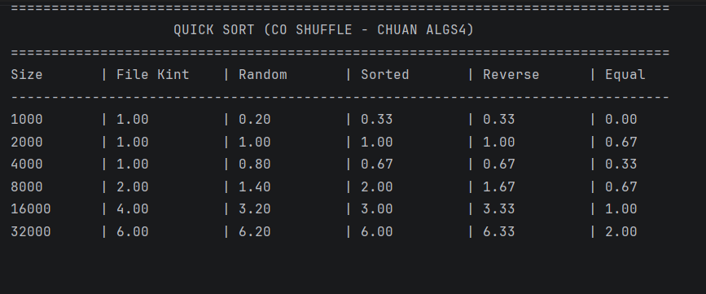
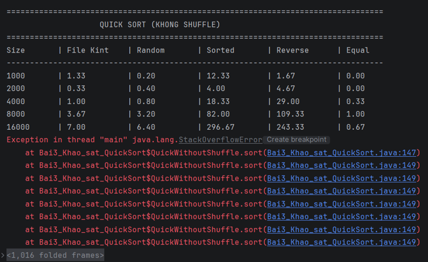

# Tuần 5: Khảo sát các thuật toán sắp xếp (QuickSort, MergeSort, InsertionSort)

Thư mục này chứa mã nguồn và báo cáo kết quả thực nghiệm các bài tập lập trình cấu trúc dữ liệu và giải thuật theo giáo trình *algs4* của Princeton.

---

## Bài 3: Khảo sát thuật toán QuickSort (Có và Không Shuffle)

Mã nguồn triển khai nằm tại file: `Bai3_Khao_sat_QuickSort.java`

### 1. Kết quả thực nghiệm QuickSort (Có Shuffle - Chuẩn algs4)
Dưới đây là bảng thời gian chạy khi áp dụng bước xáo trộn ngẫu nhiên (Shuffle) giúp đảm bảo độ phức tạp ổn định $O(N \log N)$ trên mọi loại dữ liệu:

### 2. Hiện tượng lỗi StackOverflowError ở QuickSort (Không Shuffle)
Khi bỏ qua bước xáo trộn ngẫu nhiên, các mảng đã sắp xếp sẵn (`Sorted`) hoặc nghịch đảo (`Reverse`) sẽ đẩy thuật toán vào trường hợp tồi tệ nhất $O(N^2)$, gây tràn bộ nhớ Stack ở kích thước dữ liệu lớn ($N = 32000$):
